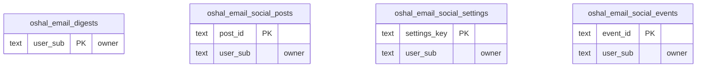

<!-- GENERATED by scripts/generate-schema-docs.js - do not edit by hand; regenerate instead. -->

# Intelligent Communication (`email-summarizer`) - database schema

Postgres database `oshal`, schema `public` - shared with the platform and every other installed package. 4 tables in the reference database.

**Migrations:** `migrations/001-email-mail-store.sql`, `migrations/002-email-social-desk.sql` (declared in `oshal-app.yaml`).

**Created at runtime by package code** (`CREATE TABLE IF NOT EXISTS`): `routes/email-app-routes.js`, `src-routes/email-app-routes.ts`

Platform conventions (ownership, RLS, how migrations run): [core data model](https://github.com/emeraldcoastsystemsgroup/oshal/blob/main/docs/architecture/data-model/README.md).

The diagram shows key columns only: primary keys (PK), foreign keys (FK), single-column unique keys (UK) and the column an RLS policy scopes rows by ("owner"). A box with no columns is a table documented on another page. Every column is listed under Tables.

## Diagram

## Tables

### `oshal_email_digests`

Defined in `routes/email-app-routes.js`, `src-routes/email-app-routes.ts` · RLS **forced** - owner `user_sub`

| Column | Type | Null | Default | Notes |
|---|---|---|---|---|
| `user_sub` | text | no |  | PK · owner |
| `summary` | text | yes |  |  |
| `updated_at` | timestamp with time zone | no | now() |  |

### `oshal_email_social_posts`

Defined in `migrations/002-email-social-desk.sql` · RLS **forced** - owner `user_sub`

| Column | Type | Null | Default | Notes |
|---|---|---|---|---|
| `post_id` | text | no |  | PK |
| `user_sub` | text | no |  | owner |
| `status` | text | no | 'draft' | draft, scheduled, sending, sent, partial, failed |
| `body` | text | no | '' | the shared text |
| `variants` | text | no | '{}' | JSON: per-channel text where it differs |
| `channels` | text | no | '[]' | JSON array of channel ids |
| `media_url` | text | no | '' | https image link |
| `event_id` | text | no | '' | the Go Live event this announces |
| `scheduled_at` | timestamp with time zone | yes |  |  |
| `sent_at` | timestamp with time zone | yes |  |  |
| `outcomes` | text | no | '{}' | JSON: per-channel ok, id, url or refusal |
| `created_at` | timestamp with time zone | no | now() |  |
| `updated_at` | timestamp with time zone | no | now() |  |

### `oshal_email_social_settings`

Defined in `migrations/002-email-social-desk.sql` · RLS **forced** - owner `user_sub`

| Column | Type | Null | Default | Notes |
|---|---|---|---|---|
| `settings_key` | text | no |  | PK · the owner's subject |
| `user_sub` | text | no |  | owner |
| `plan` | text | no | '{}' | JSON: days and times of the posting plan |
| `slack_channel` | text | no | '' | the Slack conversation id posts go to |
| `slack_label` | text | no | '' |  |
| `timezone` | text | no | '' | IANA zone |
| `updated_at` | timestamp with time zone | no | now() |  |

### `oshal_email_social_events`

Defined in `migrations/002-email-social-desk.sql` · RLS **forced** - owner `user_sub`

| Column | Type | Null | Default | Notes |
|---|---|---|---|---|
| `event_id` | text | no |  | PK |
| `user_sub` | text | no |  | owner |
| `title` | text | no | '' |  |
| `description` | text | no | '' |  |
| `start_at` | timestamp with time zone | no |  |  |
| `destinations` | text | no | '[]' | JSON array of destination ids |
| `watch_url` | text | no | '' |  |
| `status` | text | no | 'planned' |  |
| `created_at` | timestamp with time zone | no | now() |  |
