<!-- GENERATED by scripts/generate-schema-docs.js - do not edit by hand; regenerate instead. -->

# Marketing Engine (`marketing-engine`) - database schema

Postgres database `oshal`, schema `public` - shared with the platform and every other installed package. 24 tables in the reference database.

**Migrations** (declared in `oshal-app.yaml`, applied on activation, recorded in `app_package_migrations`): `migrations/001-marketing-core.sql`, `migrations/002-marketing-metrics.sql`, `migrations/003-marketing-audience.sql`, `migrations/004-marketing-compliance.sql`, `migrations/005-marketing-double-optin.sql`, `migrations/006-marketing-broadcasts.sql`, `migrations/007-marketing-sequences.sql`, `migrations/008-marketing-launch-plans.sql`, `migrations/009-marketing-finance-link.sql`, `migrations/010-marketing-attribution.sql`, `migrations/011-marketing-sms-consent.sql`

**Created at runtime by package code** (`CREATE TABLE IF NOT EXISTS`): `routes/marketing-attribution.js`, `routes/marketing-audience.js`, `routes/marketing-broadcast.js`, `routes/marketing-compliance.js`, `routes/marketing-launch.js`, `routes/marketing-ops-routes.js`, `routes/marketing-optin.js`, `routes/marketing-routes.js`, `routes/marketing-sequences.js`, `routes/marketing-sms.js`, `src-routes/marketing-attribution.ts`, `src-routes/marketing-audience.ts`, `src-routes/marketing-broadcast.ts`, `src-routes/marketing-compliance.ts`, `src-routes/marketing-launch.ts`, `src-routes/marketing-ops-routes.ts`, `src-routes/marketing-optin.ts`, `src-routes/marketing-routes.ts`, `src-routes/marketing-sequences.ts`, `src-routes/marketing-sms.ts`

Platform conventions (ownership, RLS, how migrations run): [core data model](https://github.com/emeraldcoastsystemsgroup/oshal/blob/main/docs/architecture/data-model/README.md).

The diagram shows key columns only: primary keys (PK), foreign keys (FK), single-column unique keys (UK) and the column an RLS policy scopes rows by ("owner"). A box with no columns is a table documented on another page. Every column is listed under Tables.

## Diagram

```mermaid
erDiagram
  oshal_marketing_budget_ledger {
    uuid entry_id PK
    text user_sub "owner"
  }
  oshal_marketing_campaigns {
    uuid campaign_id PK
    text user_sub "owner"
  }
  oshal_marketing_channel_authorizations {
    text user_sub PK "owner"
    text channel PK
  }
  oshal_marketing_content {
    uuid item_id PK
    text user_sub "owner"
    uuid campaign_id FK
  }
  oshal_marketing_events {
    uuid event_id PK
    text user_sub "owner"
  }
  oshal_marketing_experiments {
    uuid experiment_id PK
    text user_sub "owner"
  }
  oshal_marketing_run_ledger {
    uuid run_id PK
    text user_sub "owner"
  }
  oshal_marketing_scorecard_weeks {
    text user_sub PK "owner"
    date week_start PK
  }
  oshal_marketing_contacts {
    uuid contact_id PK
    text owner_sub "owner"
  }
  oshal_marketing_consents {
    uuid consent_id PK
    text owner_sub "owner"
    uuid contact_id FK
  }
  oshal_marketing_lists {
    uuid list_id PK
    text owner_sub "owner"
  }
  oshal_marketing_list_members {
    text owner_sub "owner"
    uuid list_id PK,FK
    uuid contact_id PK,FK
  }
  oshal_marketing_suppressions {
    uuid suppression_id PK
    text owner_sub "owner"
  }
  oshal_marketing_compliance_settings {
    text owner_sub PK "owner"
  }
  oshal_marketing_signup_forms {
    uuid form_id PK
    text owner_sub "owner"
    uuid list_id FK
  }
  oshal_marketing_optin_tokens {
    uuid token_id PK
    text owner_sub "owner"
    uuid form_id FK
    uuid contact_id FK
    uuid consent_id FK
  }
  oshal_marketing_messages {
    uuid message_id PK
    text owner_sub "owner"
    uuid campaign_id FK
    uuid list_id FK
  }
  oshal_marketing_deliveries {
    uuid delivery_id PK
    text owner_sub "owner"
    uuid message_id FK
    uuid contact_id FK
  }
  oshal_marketing_sequences {
    uuid sequence_id PK
    text owner_sub "owner"
  }
  oshal_marketing_sequence_steps {
    uuid step_id PK
    text owner_sub "owner"
    uuid sequence_id FK
  }
  oshal_marketing_enrollments {
    uuid enrollment_id PK
    text owner_sub "owner"
    uuid sequence_id FK
    uuid contact_id FK
  }
  oshal_marketing_launch_plans {
    uuid plan_id PK
    text owner_sub "owner"
    uuid campaign_id FK
  }
  oshal_marketing_conversions {
    uuid conversion_id PK
    text owner_sub "owner"
    uuid contact_id FK
  }
  oshal_marketing_sms_queue {
    uuid sms_id PK
    text owner_sub "owner"
    uuid contact_id FK
  }
  oshal_marketing_campaigns |o--o{ oshal_marketing_content : "campaign_id"
  oshal_marketing_campaigns ||--o| oshal_marketing_launch_plans : "campaign_id"
  oshal_marketing_campaigns |o--o{ oshal_marketing_messages : "campaign_id"
  oshal_marketing_contacts ||--o{ oshal_marketing_consents : "contact_id"
  oshal_marketing_contacts ||--o{ oshal_marketing_list_members : "contact_id"
  oshal_marketing_lists ||--o{ oshal_marketing_list_members : "list_id"
  oshal_marketing_lists |o--o{ oshal_marketing_signup_forms : "list_id"
  oshal_marketing_lists ||--o{ oshal_marketing_messages : "list_id"
  oshal_marketing_signup_forms ||--o{ oshal_marketing_optin_tokens : "form_id"
  oshal_marketing_contacts ||--o{ oshal_marketing_optin_tokens : "contact_id"
  oshal_marketing_consents ||--o{ oshal_marketing_optin_tokens : "consent_id"
  oshal_marketing_messages ||--o{ oshal_marketing_deliveries : "message_id"
  oshal_marketing_contacts |o--o{ oshal_marketing_deliveries : "contact_id"
  oshal_marketing_sequences ||--o{ oshal_marketing_sequence_steps : "sequence_id"
  oshal_marketing_sequences ||--o{ oshal_marketing_enrollments : "sequence_id"
  oshal_marketing_contacts ||--o{ oshal_marketing_enrollments : "contact_id"
  oshal_marketing_contacts |o--o{ oshal_marketing_conversions : "contact_id"
  oshal_marketing_contacts ||--o{ oshal_marketing_sms_queue : "contact_id"
```

## Tables

### `oshal_marketing_budget_ledger`

Defined in `migrations/001-marketing-core.sql`, `routes/marketing-routes.js`, `src-routes/marketing-routes.ts` · RLS **forced** - owner `user_sub`

| Column | Type | Null | Default | Notes |
|---|---|---|---|---|
| `entry_id` | uuid | no | gen_random_uuid() | PK |
| `user_sub` | text | no |  | owner |
| `campaign_id` | uuid | yes |  |  |
| `channel` | text | yes |  |  |
| `field` | text | no |  |  |
| `old_value` | text | yes |  |  |
| `new_value` | text | no |  |  |
| `status` | text | no | 'proposed' |  |
| `proposed_by` | text | no | 'bot' |  |
| `decided_by` | text | yes |  |  |
| `decided_at` | timestamp with time zone | yes |  |  |
| `created_at` | timestamp with time zone | no | now() |  |

### `oshal_marketing_campaigns`

Defined in `migrations/001-marketing-core.sql`, `routes/marketing-routes.js`, `src-routes/marketing-routes.ts` · RLS **forced** - owner `user_sub`

| Column | Type | Null | Default | Notes |
|---|---|---|---|---|
| `campaign_id` | uuid | no | gen_random_uuid() | PK |
| `user_sub` | text | no |  | owner |
| `product` | text | no |  |  |
| `name` | text | no |  |  |
| `slug` | text | no |  |  |
| `motion` | text | no | 'adoption' |  |
| `stage` | integer | no | 0 |  |
| `status` | text | no | 'draft' |  |
| `icp` | jsonb | no | '{}' |  |
| `message_map` | jsonb | no | '{}' |  |
| `channels` | jsonb | no | '[]' |  |
| `budget_monthly_usd` | numeric | no | 0 |  |
| `target_cpa_usd` | numeric | yes |  |  |
| `finance_project_id` | uuid | yes |  | Added in `009-marketing-finance-link.sql` — linked Finance project UUID |
| `channel_allocations` | jsonb | no | '{}' | Added in `009-marketing-finance-link.sql` — per-channel integer-cent allocation map |
| `created_at` | timestamp with time zone | no | now() |  |
| `updated_at` | timestamp with time zone | no | now() |  |

### `oshal_marketing_channel_authorizations`

Defined in `migrations/001-marketing-core.sql`, `routes/marketing-routes.js`, `src-routes/marketing-routes.ts` · RLS **forced** - owner `user_sub`

| Column | Type | Null | Default | Notes |
|---|---|---|---|---|
| `user_sub` | text | no |  | PK · owner |
| `channel` | text | no |  | PK |
| `enabled` | boolean | no | false |  |
| `standing_authorization` | boolean | no | false |  |
| `daily_cap` | integer | no | 0 |  |
| `paused_reason` | text | yes |  |  |
| `updated_at` | timestamp with time zone | no | now() |  |

### `oshal_marketing_content`

Defined in `migrations/001-marketing-core.sql`, `routes/marketing-routes.js`, `src-routes/marketing-routes.ts` · RLS **forced** - owner `user_sub`

| Column | Type | Null | Default | Notes |
|---|---|---|---|---|
| `item_id` | uuid | no | gen_random_uuid() | PK |
| `user_sub` | text | no |  | owner |
| `campaign_id` | uuid | yes |  | FK → [`oshal_marketing_campaigns.campaign_id`](#oshal_marketing_campaigns) |
| `channel` | text | no |  |  |
| `title` | text | no | '' |  |
| `body` | text | no |  |  |
| `status` | text | no | 'draft' |  |
| `utm_url` | text | yes |  |  |
| `published_ref` | text | yes |  |  |
| `template_id` | text | yes |  | Added in `004-marketing-compliance.sql` (`announcement`, `newsletter`, `launch`) |
| `html_body` | text | yes |  | Added in `004-marketing-compliance.sql` |
| `text_body` | text | yes |  | Added in `004-marketing-compliance.sql` |
| `scheduled_for` | timestamp with time zone | yes |  | Added in `008-marketing-launch-plans.sql` for unified calendar scheduling |
| `created_at` | timestamp with time zone | no | now() |  |
| `updated_at` | timestamp with time zone | no | now() |  |

### `oshal_marketing_events`

Defined in `migrations/002-marketing-metrics.sql`, `routes/marketing-ops-routes.js`, `src-routes/marketing-ops-routes.ts` · RLS **forced** - owner `user_sub`

| Column | Type | Null | Default | Notes |
|---|---|---|---|---|
| `event_id` | uuid | no | gen_random_uuid() | PK |
| `user_sub` | text | no |  | owner |
| `ts` | timestamp with time zone | no |  |  |
| `source` | text | no |  |  |
| `campaign_slug` | text | yes |  |  |
| `medium` | text | yes |  |  |
| `event` | text | no |  |  |
| `value` | numeric | no | 0 |  |
| `meta` | jsonb | no | '{}' |  |

### `oshal_marketing_experiments`

Defined in `migrations/001-marketing-core.sql`, `routes/marketing-routes.js`, `src-routes/marketing-routes.ts` · RLS **forced** - owner `user_sub`

| Column | Type | Null | Default | Notes |
|---|---|---|---|---|
| `experiment_id` | uuid | no | gen_random_uuid() | PK |
| `user_sub` | text | no |  | owner |
| `campaign_id` | uuid | yes |  |  |
| `hypothesis` | text | no |  |  |
| `variable` | text | no |  |  |
| `ice_impact` | integer | no |  |  |
| `ice_confidence` | integer | no |  |  |
| `ice_ease` | integer | no |  |  |
| `status` | text | no | 'proposed' |  |
| `window_start` | date | yes |  |  |
| `window_end` | date | yes |  |  |
| `verdict` | text | yes |  |  |
| `created_at` | timestamp with time zone | no | now() |  |
| `updated_at` | timestamp with time zone | no | now() |  |

### `oshal_marketing_run_ledger`

Defined in `migrations/002-marketing-metrics.sql`, `routes/marketing-ops-routes.js`, `src-routes/marketing-ops-routes.ts` · RLS **forced** - owner `user_sub`

| Column | Type | Null | Default | Notes |
|---|---|---|---|---|
| `run_id` | uuid | no | gen_random_uuid() | PK |
| `user_sub` | text | no |  | owner |
| `channel` | text | no |  |  |
| `action` | text | no |  |  |
| `outcome` | text | no |  |  |
| `detail` | jsonb | no | '{}' |  |
| `ts` | timestamp with time zone | no | now() |  |

### `oshal_marketing_scorecard_weeks`

Defined in `migrations/002-marketing-metrics.sql`, `routes/marketing-ops-routes.js`, `src-routes/marketing-ops-routes.ts` · RLS **forced** - owner `user_sub`

| Column | Type | Null | Default | Notes |
|---|---|---|---|---|
| `user_sub` | text | no |  | PK · owner |
| `week_start` | date | no |  | PK |
| `data` | jsonb | no |  |  |
| `sources` | jsonb | no | '{}' |  |
| `computed_at` | timestamp with time zone | no | now() |  |

### `oshal_marketing_contacts`

Defined in `migrations/003-marketing-audience.sql`, `routes/marketing-audience.js`, `src-routes/marketing-audience.ts` · RLS **forced** - exact owner `owner_sub`

| Column | Type | Null | Default | Notes |
|---|---|---|---|---|
| `contact_id` | uuid | no | gen_random_uuid() | PK |
| `owner_sub` | text | no |  | owner |
| `email` | text | no |  |  |
| `email_hash` | text | no |  | unique with `owner_sub` |
| `display_name` | text | no | '' |  |
| `tags` | jsonb | no | '[]' |  |
| `status` | text | no | 'active' |  |
| `metadata` | jsonb | no | '{}' |  |
| `phone_e164` | text | yes |  | Added in `011-marketing-sms-consent.sql` — E.164 recipient phone |
| `phone_hash` | text | yes |  | Added in `011-marketing-sms-consent.sql` — SHA-256 hex digest of E.164 phone (indexed with `owner_sub`) |
| `timezone` | text | yes |  | Added in `011-marketing-sms-consent.sql` — canonical IANA recipient time zone |
| `timezone_inferred` | boolean | no | false | Added in `011-marketing-sms-consent.sql` — `true` when inferred from phone area code |
| `created_at` | timestamp with time zone | no | now() |  |
| `updated_at` | timestamp with time zone | no | now() |  |

### `oshal_marketing_consents`

Defined in `migrations/003-marketing-audience.sql`, `routes/marketing-audience.js`, `src-routes/marketing-audience.ts` · RLS **forced** - exact owner `owner_sub`

| Column | Type | Null | Default | Notes |
|---|---|---|---|---|
| `consent_id` | uuid | no | gen_random_uuid() | PK |
| `owner_sub` | text | no |  | owner |
| `contact_id` | uuid | no |  | FK → [`oshal_marketing_contacts.contact_id`](#oshal_marketing_contacts) (ON DELETE CASCADE) |
| `channel` | text | no |  |  |
| `purpose` | text | no | 'marketing' |  |
| `status` | text | no | 'pending' |  |
| `evidence` | jsonb | no | '{}' | `{ formText, recordedAt, ip, userAgent, utm, tokenHash }` plus CSV attestation fields (`consentSource`, `attestation`, `importBatchId`, `rowNumber`, `priorConsentDocumented`) when imported via `POST /audience/contacts/import-csv` |
| `created_at` | timestamp with time zone | no | now() |  |
| `updated_at` | timestamp with time zone | no | now() |  |

### `oshal_marketing_lists`

Defined in `migrations/003-marketing-audience.sql`, `routes/marketing-audience.js`, `src-routes/marketing-audience.ts` · RLS **forced** - exact owner `owner_sub`

| Column | Type | Null | Default | Notes |
|---|---|---|---|---|
| `list_id` | uuid | no | gen_random_uuid() | PK |
| `owner_sub` | text | no |  | owner |
| `slug` | text | no |  | unique with `owner_sub` |
| `name` | text | no |  |  |
| `description` | text | no | '' |  |
| `created_at` | timestamp with time zone | no | now() |  |
| `updated_at` | timestamp with time zone | no | now() |  |

### `oshal_marketing_list_members`

Defined in `migrations/003-marketing-audience.sql`, `routes/marketing-audience.js`, `src-routes/marketing-audience.ts` · RLS **forced** - exact owner `owner_sub`

| Column | Type | Null | Default | Notes |
|---|---|---|---|---|
| `owner_sub` | text | no |  | owner |
| `list_id` | uuid | no |  | PK · FK → [`oshal_marketing_lists.list_id`](#oshal_marketing_lists) (ON DELETE CASCADE) |
| `contact_id` | uuid | no |  | PK · FK → [`oshal_marketing_contacts.contact_id`](#oshal_marketing_contacts) (ON DELETE CASCADE) |
| `added_at` | timestamp with time zone | no | now() |  |

### `oshal_marketing_suppressions`

Defined in `migrations/003-marketing-audience.sql`, `routes/marketing-audience.js`, `src-routes/marketing-audience.ts` · RLS **forced** - exact owner `owner_sub`

| Column | Type | Null | Default | Notes |
|---|---|---|---|---|
| `suppression_id` | uuid | no | gen_random_uuid() | PK |
| `owner_sub` | text | no |  | owner |
| `channel` | text | no | 'email' | unique with `owner_sub`, `address_hash` |
| `address_hash` | text | no |  | normalized SHA-256 hex |
| `reason` | text | no |  |  |
| `source` | text | no | 'manual' |  |
| `created_at` | timestamp with time zone | no | now() |  |

### `oshal_marketing_compliance_settings`

Defined in `migrations/004-marketing-compliance.sql`, `routes/marketing-compliance.js`, `src-routes/marketing-compliance.ts` · RLS **forced** - exact owner `owner_sub`

| Column | Type | Null | Default | Notes |
|---|---|---|---|---|
| `owner_sub` | text | no |  | PK · owner |
| `sender_name` | text | no | '' |  |
| `sender_email` | text | no | '' |  |
| `reply_to_email` | text | no | '' |  |
| `postal_address` | text | no | '' |  |
| `unsubscribe_base_url` | text | no | '' |  |
| `sms_quiet_start_hour` | integer | no | 21 | CHECK 0..23 |
| `sms_quiet_end_hour` | integer | no | 8 | CHECK 0..23 |
| `sms_default_timezone` | text | no | 'America/New_York' |  |
| `updated_at` | timestamp with time zone | no | now() |  |

### `oshal_marketing_signup_forms`

Defined in `migrations/005-marketing-double-optin.sql`, `routes/marketing-optin.js`, `src-routes/marketing-optin.ts` · RLS **forced** - exact owner `owner_sub`

| Column | Type | Null | Default | Notes |
|---|---|---|---|---|
| `form_id` | uuid | no | gen_random_uuid() | PK |
| `owner_sub` | text | no |  | owner |
| `slug` | text | no |  | unique with `owner_sub` |
| `name` | text | no |  |  |
| `consent_text` | text | no |  | recorded verbatim in consent evidence |
| `list_id` | uuid | yes |  | FK → [`oshal_marketing_lists.list_id`](#oshal_marketing_lists) (ON DELETE SET NULL) |
| `honeypot_field` | text | no | 'company_website' |  |
| `signing_secret` | text | no |  | per-form 32-byte random hex secret (never returned by API) |
| `rate_limit_per_ip_hour` | integer | no | 10 | CHECK 1..1000 |
| `rate_limit_per_form_hour` | integer | no | 200 | CHECK 1..10000 |
| `token_ttl_minutes` | integer | no | 1440 | CHECK 5..10080 |
| `confirmation_base_url` | text | no | '' |  |
| `enabled` | boolean | no | true |  |
| `created_at` | timestamp with time zone | no | now() |  |
| `updated_at` | timestamp with time zone | no | now() |  |

### `oshal_marketing_optin_tokens`

Defined in `migrations/005-marketing-double-optin.sql`, `routes/marketing-optin.js`, `src-routes/marketing-optin.ts` · RLS **forced** - exact owner `owner_sub`

| Column | Type | Null | Default | Notes |
|---|---|---|---|---|
| `token_id` | uuid | no | gen_random_uuid() | PK |
| `owner_sub` | text | no |  | owner |
| `form_id` | uuid | no |  | FK → [`oshal_marketing_signup_forms.form_id`](#oshal_marketing_signup_forms) (ON DELETE CASCADE) |
| `contact_id` | uuid | no |  | FK → [`oshal_marketing_contacts.contact_id`](#oshal_marketing_contacts) (ON DELETE CASCADE) |
| `consent_id` | uuid | no |  | FK → [`oshal_marketing_consents.consent_id`](#oshal_marketing_consents) (ON DELETE CASCADE) |
| `token_hash` | text | no |  | SHA-256 hex digest of signed token (raw token never stored); unique with `owner_sub` |
| `expires_at` | timestamp with time zone | no |  |  |
| `consumed_at` | timestamp with time zone | yes |  | atomic single-use stamp |
| `created_at` | timestamp with time zone | no | now() |  |

### `oshal_marketing_messages`

Defined in `migrations/006-marketing-broadcasts.sql`, `routes/marketing-broadcast.js`, `src-routes/marketing-broadcast.ts` · RLS **forced** - exact owner `owner_sub`

| Column | Type | Null | Default | Notes |
|---|---|---|---|---|
| `message_id` | uuid | no | gen_random_uuid() | PK |
| `owner_sub` | text | no |  | owner |
| `campaign_id` | uuid | yes |  | FK → [`oshal_marketing_campaigns.campaign_id`](#oshal_marketing_campaigns) (ON DELETE SET NULL) |
| `list_id` | uuid | no |  | FK → [`oshal_marketing_lists.list_id`](#oshal_marketing_lists) (ON DELETE CASCADE) |
| `template_id` | text | no |  | CHECK (`announcement`, `newsletter`, `launch`) |
| `subject` | text | no |  |  |
| `headline` | text | no | '' |  |
| `intro` | text | no | '' |  |
| `body` | text | no |  |  |
| `cta_label` | text | no | '' |  |
| `cta_url` | text | no | '' |  |
| `status` | text | no | 'draft' | CHECK (`draft`, `approved`, `sent`, `partial`, `blocked`) |
| `signing_secret` | text | no |  | per-message 32-byte random hex secret for unsubscribe tokens (never returned by API) |
| `stats` | jsonb | no | '{}' | aggregate gate and delivery counts |
| `created_at` | timestamp with time zone | no | now() |  |
| `updated_at` | timestamp with time zone | no | now() |  |

### `oshal_marketing_deliveries`

Defined in `migrations/006-marketing-broadcasts.sql`, `routes/marketing-broadcast.js`, `src-routes/marketing-broadcast.ts` · RLS **forced** - exact owner `owner_sub`

| Column | Type | Null | Default | Notes |
|---|---|---|---|---|
| `delivery_id` | uuid | no | gen_random_uuid() | PK |
| `owner_sub` | text | no |  | owner |
| `message_id` | uuid | no |  | FK → [`oshal_marketing_messages.message_id`](#oshal_marketing_messages) (ON DELETE CASCADE) |
| `contact_id` | uuid | yes |  | FK → [`oshal_marketing_contacts.contact_id`](#oshal_marketing_contacts) (ON DELETE SET NULL) |
| `email_hash` | text | no |  | normalized SHA-256 hex |
| `status` | text | no |  | CHECK (`sent`, `dry_run`, `skipped_consent`, `skipped_unconfirmed`, `skipped_suppressed`, `skipped_compliance`, `skipped_cap`, `skipped_confirm`, `error`) |
| `gate_reason` | text | no | '' | explicit gate decision code |
| `provider_ref` | text | yes |  | Resend message reference on live send |
| `clicked_at` | timestamp with time zone | yes |  | Added in `010-marketing-attribution.sql` — first click event timestamp |
| `bounced_at` | timestamp with time zone | yes |  | Added in `010-marketing-attribution.sql` — bounce event timestamp (auto-suppresses) |
| `complained_at` | timestamp with time zone | yes |  | Added in `010-marketing-attribution.sql` — complaint event timestamp (auto-suppresses) |
| `unsubscribed_at` | timestamp with time zone | yes |  | Added in `010-marketing-attribution.sql` — unsubscribe event timestamp (auto-suppresses) |
| `created_at` | timestamp with time zone | no | now() |  |

### `oshal_marketing_sequences`

Defined in `migrations/007-marketing-sequences.sql`, `routes/marketing-sequences.js`, `src-routes/marketing-sequences.ts` · RLS **forced** - exact owner `owner_sub`

| Column | Type | Null | Default | Notes |
|---|---|---|---|---|
| `sequence_id` | uuid | no | gen_random_uuid() | PK |
| `owner_sub` | text | no |  | owner |
| `slug` | text | no |  | unique with `owner_sub` |
| `name` | text | no |  |  |
| `description` | text | no | '' |  |
| `trigger_form_slug` | text | yes |  | optional sign-up form slug for welcome auto-enrollment |
| `status` | text | no | 'draft' | CHECK (`draft`, `active`, `paused`, `archived`) |
| `standing_authorization` | boolean | no | false | strict boolean; default OFF |
| `daily_cap` | integer | no | 0 | CHECK 0..5000 |
| `signing_secret` | text | no |  | per-sequence 32-byte random hex secret (never returned by API) |
| `created_at` | timestamp with time zone | no | now() |  |
| `updated_at` | timestamp with time zone | no | now() |  |

### `oshal_marketing_sequence_steps`

Defined in `migrations/007-marketing-sequences.sql`, `routes/marketing-sequences.js`, `src-routes/marketing-sequences.ts` · RLS **forced** - exact owner `owner_sub`

| Column | Type | Null | Default | Notes |
|---|---|---|---|---|
| `step_id` | uuid | no | gen_random_uuid() | PK |
| `owner_sub` | text | no |  | owner |
| `sequence_id` | uuid | no |  | FK → [`oshal_marketing_sequences.sequence_id`](#oshal_marketing_sequences) (ON DELETE CASCADE) |
| `step_order` | integer | no |  | CHECK 1..50; unique with `sequence_id` |
| `delay_hours` | integer | no | 0 | CHECK 0..8760 |
| `template_id` | text | no |  | CHECK (`announcement`, `newsletter`, `launch`) |
| `subject` | text | no |  |  |
| `headline` | text | no | '' |  |
| `intro` | text | no | '' |  |
| `body` | text | no |  |  |
| `cta_label` | text | no | '' |  |
| `cta_url` | text | no | '' |  |
| `created_at` | timestamp with time zone | no | now() |  |

### `oshal_marketing_enrollments`

Defined in `migrations/007-marketing-sequences.sql`, `routes/marketing-sequences.js`, `src-routes/marketing-sequences.ts` · RLS **forced** - exact owner `owner_sub`

| Column | Type | Null | Default | Notes |
|---|---|---|---|---|
| `enrollment_id` | uuid | no | gen_random_uuid() | PK |
| `owner_sub` | text | no |  | owner |
| `sequence_id` | uuid | no |  | FK → [`oshal_marketing_sequences.sequence_id`](#oshal_marketing_sequences) (ON DELETE CASCADE) |
| `contact_id` | uuid | no |  | FK → [`oshal_marketing_contacts.contact_id`](#oshal_marketing_contacts) (ON DELETE CASCADE); unique with `sequence_id` |
| `current_step_order` | integer | no | 0 |  |
| `status` | text | no | 'active' | CHECK (`active`, `completed`, `stopped_unsubscribed`, `stopped_unconsented`, `paused`) |
| `next_run_at` | timestamp with time zone | no | now() |  |
| `last_step_at` | timestamp with time zone | yes |  |  |
| `history` | jsonb | no | '[]' | per-step decision audit trail |
| `created_at` | timestamp with time zone | no | now() |  |
| `updated_at` | timestamp with time zone | no | now() |  |

### `oshal_marketing_launch_plans`

Defined in `migrations/008-marketing-launch-plans.sql`, `routes/marketing-launch.js`, `src-routes/marketing-launch.ts` · RLS **forced** - exact owner `owner_sub`

| Column | Type | Null | Default | Notes |
|---|---|---|---|---|
| `plan_id` | uuid | no | gen_random_uuid() | PK |
| `owner_sub` | text | no |  | owner |
| `campaign_id` | uuid | no |  | FK → [`oshal_marketing_campaigns.campaign_id`](#oshal_marketing_campaigns) (ON DELETE CASCADE); unique with `owner_sub` |
| `title` | text | no |  |  |
| `launch_date` | date | no |  |  |
| `status` | text | no | 'planning' | CHECK (`planning`, `ready`, `launched`, `retro_complete`) |
| `milestones` | jsonb | no | '[]' | dated milestone items (`id`, `title`, `dueDate`, `ownerRole`, `status`) |
| `checklist` | jsonb | no | '[]' | asset checklist items (`id`, `label`, `category`, `done`) |
| `retro_markdown` | text | yes |  | grounded recorded-numbers-only retro markdown |
| `retro_facts` | jsonb | yes |  | structured recorded facts & `NO DATA` per source |
| `retro_generated_at` | timestamp with time zone | yes |  |  |
| `created_at` | timestamp with time zone | no | now() |  |
| `updated_at` | timestamp with time zone | no | now() |  |

### `oshal_marketing_conversions`

Defined in `migrations/010-marketing-attribution.sql`, `routes/marketing-attribution.js`, `src-routes/marketing-attribution.ts` · RLS **forced** - exact owner `owner_sub`

| Column | Type | Null | Default | Notes |
|---|---|---|---|---|
| `conversion_id` | uuid | no | gen_random_uuid() | PK |
| `owner_sub` | text | no |  | owner |
| `contact_id` | uuid | yes |  | FK → [`oshal_marketing_contacts.contact_id`](#oshal_marketing_contacts) (ON DELETE SET NULL) |
| `campaign_slug` | text | yes |  | first-touch attributed campaign slug |
| `medium` | text | yes |  | attributed medium |
| `source` | text | yes |  | attributed source |
| `kind` | text | no |  | CHECK (`signup`, `purchase`, `activation`) |
| `amount_cents` | bigint | no | 0 | CHECK `>= 0` |
| `reference_id` | text | yes |  | external order or sign-up reference |
| `utm` | jsonb | no | '{}' | canonical `utm_*` attribution map |
| `occurred_at` | timestamp with time zone | no | now() |  |
| `created_at` | timestamp with time zone | no | now() |  |

### `oshal_marketing_sms_queue`

Defined in `migrations/011-marketing-sms-consent.sql`, `routes/marketing-sms.js`, `src-routes/marketing-sms.ts` · RLS **forced** - exact owner `owner_sub`

| Column | Type | Null | Default | Notes |
|---|---|---|---|---|
| `sms_id` | uuid | no | gen_random_uuid() | PK |
| `owner_sub` | text | no |  | owner |
| `contact_id` | uuid | no |  | FK → [`oshal_marketing_contacts.contact_id`](#oshal_marketing_contacts) (ON DELETE CASCADE) |
| `phone_hash` | text | no |  | normalized SHA-256 hex of recipient E.164 phone |
| `body` | text | no |  | SMS message body |
| `recipient_timezone` | text | no |  | canonical IANA recipient time zone |
| `timezone_inferred` | boolean | no | false | `true` when inferred from phone area code |
| `status` | text | no |  | CHECK (`held_quiet_hours`, `ready`, `refused_consent`, `refused_suppressed`, `sent`, `cancelled`) |
| `gate_reason` | text | no | '' | explicit gate verdict code |
| `scheduled_for` | timestamp with time zone | no |  | clock instant evaluated |
| `release_at` | timestamp with time zone | yes |  | exact next recipient-local `08:00` UTC timestamp when held |
| `created_at` | timestamp with time zone | no | now() |  |
